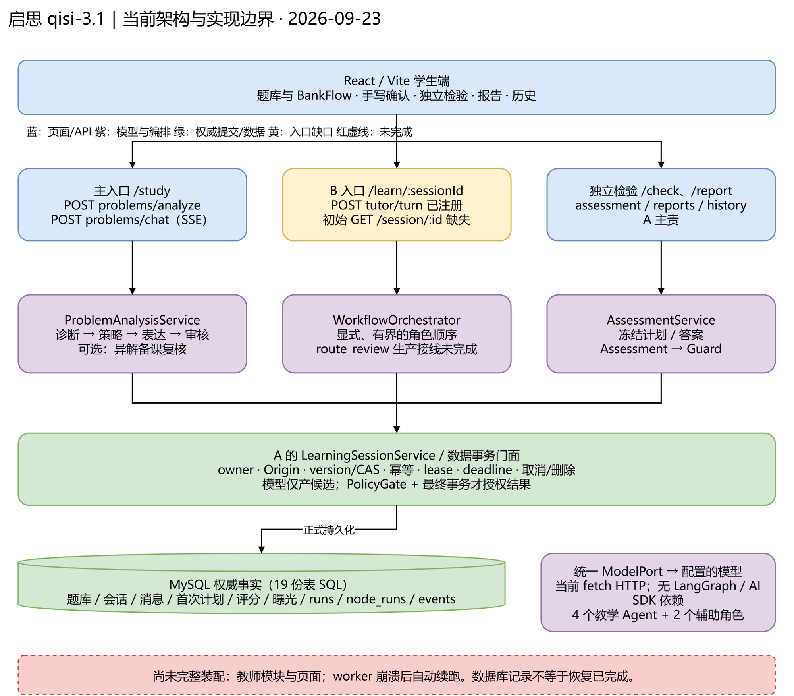
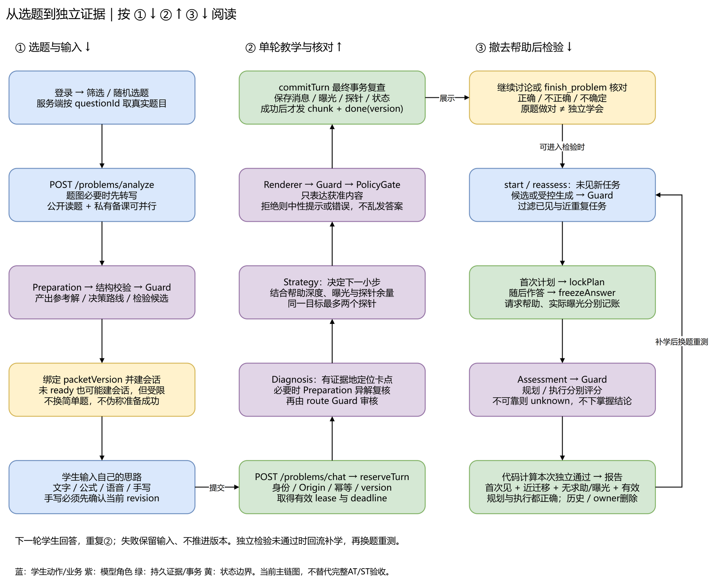
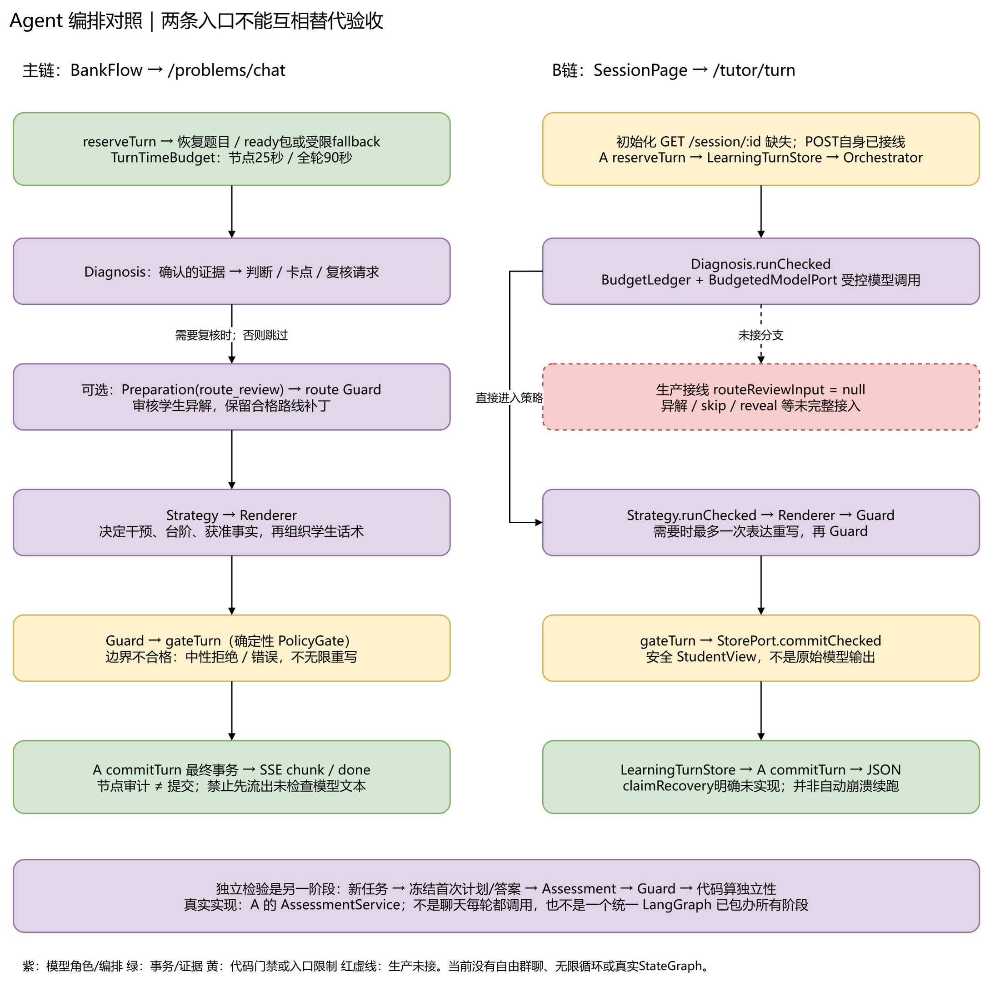

# 启思 qisi-3.1：A/B 进度、接口与多 Agent 设计全解

核查日期：2026-09-23。代码快照：develop，HEAD `2b4b03c`。产品基线：qisi-3.1。

本文是对当前仓库的说明，不是新的 PRD、上线证明或验收签字。依据顺序：当前运行接线与源码 → 本轮检查 → 日期明确的历史证据 → 任务/交接记录。没有连接业务数据库、没有调用真实模型、没有进行真人教学评估。

## 1. 先用大白话说结论

这不是“把题目丢给一个聊天机器人，让它一直讲答案”。我们想做的是：先在后台备课，再看学生到底卡在哪里，决定这次该问一句、提示一点，还是按学生要求讲清楚；讲完不算学会，还要换一道没见过的题，撤掉帮助，看学生能不能自己选方法、自己做出来。

A/B 是两位开发者的责任分工，不是两个产品 Agent，也不是“A 只做前端、B 只做后端”。A 偏题库、输入、数据底座、独立检验与报告；B 偏备课、诊断、教学策略、表达审核和流程编排。两边都涉及前端和后端。

**产品有 4 个教学 Agent：Preparation、Diagnosis、Strategy、Assessment；再加 Renderer、Guard 两个辅助模型角色。合计 4+2 类角色，不是 6 个独立进程，也不要求 6 个不同模型。** 图片转写和语音是输入能力，不另算教学 Agent。

**当前已有大量实现，但不能说 A/B 全部完成。** 任务表 20 张卡中，正式 done 为 0：A 有 9 张 planned、A06 为 implemented_waiting_review；B 的 10 张均为 in_progress。部分交接写“实现待复核”，与任务表不同步；不能把 planned 理解成完全没写，也不能把有代码理解成验收通过。

**实际有两条教学入口，整合尚未收口。** /study 的 BankFlow 走 /api/problems/analyze 和 /api/problems/chat；B 的 /learn/:sessionId 页面走 /api/tutor/turn。后者页面已注册，但初始化请求的 GET /api/session/:id 在当前服务端不存在。教师模块、worker 自动恢复也没有完整生产接线。

**本轮真实结果：后端 637 passed、19 skipped；前端 128 passed、2 failed；根 typecheck 失败于前端 three 类型。** 所以现在不能写“当前全量测试通过、可以正式发布”。

## 2. 总体架构：每层管什么



前端像“学生课桌”：选题、写思路、拍照确认、选帮助深度、看报告。后端像“教研组加教务处”：模型角色提供候选判断，确定性规则审核边界，事务服务才有权保存最终事实。MySQL 像“正式档案”：谁做了哪题、看到过什么提示、第一次计划是什么，都以档案为准，不能靠刷新页面洗掉。

| 层 | 当前代码与作用 | 不要误解为 |
| --- | --- | --- |
| React/Vite 前端 | web/；题库、BankFlow、手写、检验、报告、历史；PC/H5 组件 | 页面显示成功不代表学习证据成立 |
| NestJS 用例层 | server/src/features/；鉴权、收输入、调用角色、组织事务 | Controller 不能把模型 JSON 直接当可信事实 |
| Agent/Prompt/Schema | agents/、prompts/、contracts/；分角色、分上下文、分输出结构 | 不是一个大提示词里写六个名字 |
| 编排与规则 | workflows/ 和主链 ProblemAnalysisService；有界调用、PolicyGate | 当前没有实际使用 LangGraph StateGraph |
| 模型网关 | OpenAiCompatibleModelPort，统一 HTTP 调用配置的模型 | 当前未安装 AI SDK Core；目标配置不等于运行证据 |
| 存储 | mysql2/Kysely；server/db/ 的 19 个按表 SQL 文件 | 生产不是只靠 MemoryStore；持久化也不等于自动续跑 |

目标规格允许 NestJS + 可选 LangGraph.js，runtime 里有图、worker、AI SDK 字段；当前 server/package.json 没有 LangGraph/AI SDK 依赖，实际运行是 Nest 服务及显式编排类。本文不把未来设计画成已落地。

## 3. A 做了什么、还差什么

“已有实现”依据当前文件与调用点；“验收缺口”包括整卡要求尚未闭合，不能用局部通过替代整张卡。

| 卡 | 任务表状态 | 当前可确认的实现 | 仍不能宣布 done 的原因 |
| --- | --- | --- | --- |
| A01 基础设施 | planned | React/Nest workspace、认证、公共渲染、DB门面、19份DDL、事务/租约/节点记录 | 交接仍in_progress；完整技术门禁和复核未闭合；本轮前端类型检查失败 |
| A02 题库与选题 | planned | 试卷/题目查询、筛选、随机选题、分析/备课衔接、会话恢复 | 随机request_id跨重启持久化等未闭合；全题池覆盖与准备质量未全验收 |
| A03 输入与确认 | planned | 手写上传、sharp解码、视觉转写、逐行确认、revision校验、私有媒体；另有语音/公式整理/朗读 | 交接为implemented_waiting_review，与tasks不同步；真手写质量、完整验收和独立复核未全过 |
| A04 独立检验 | planned | 新任务筛选/生成、Guard、首次计划和最终答案冻结、草稿、求助标记 | 交接为implemented_waiting_review；任务新颖性和难度等仍需真实/人工验收 |
| A05 评分报告 | planned | Assessment规划/执行分开评分、Guard、独立性代码计算、报告与下一步 | 交接为implemented_waiting_review；模型评分不等于教学有效性已验证 |
| A06 重测历史删除 | implemented_waiting_review | 不同任务重测、历史展开/筛选、报告跳转、owner删除、关联清理 | 待独立复核；生产清理调度未验证；历史单条真模型样本不是统计验证 |
| A07 故障/归属/部署 | planned | owner、CAS、幂等、过期/删除防迟到提交等底座代码 | 完整竞态/崩溃/部署矩阵未确认；无该卡独立handoff |
| A08 全题库与E2E | planned | 有题库脚本、测试和E2E用例/历史产物 | 全题库审计与目标环境全量验收未确认；本轮未跑浏览器；无该卡独立handoff |
| A09 体验与演示 | planned | PC/H5、输入体验、历史/报告CTA、四视口和键盘历史自动化 | 交接in_progress；真实学生观察未完成；本轮登录页测试失败 |
| A10 发布部署 | planned | 有部署配置、脚本和文档基础 | 正式发布/回滚/目标环境验收未闭合；无该卡独立handoff |

A01 的 2026-09-22 记录包含隔离 MySQL 8.4 定向修复/验证，不能笼统说“从没测过8.4”。其他历史卡有仅基于 MySQL 8.0.45 的结果，不能拿 A01 一项通过覆盖全部8.4正式门禁。本轮未重跑MySQL。

## 4. B 做了什么、还差什么

| 卡 | 任务表状态 | 当前可确认的实现 | 仍不能宣布 done 的原因 |
| --- | --- | --- | --- |
| B01 契约与Agent内核 | in_progress | 角色Schema、上下文投影、Prompt、ModelPort、预算类、显式编排、StudentView | 角色隔离测试不等于AT13正式验收；两种ModelPort和多条运行接线仍在整合 |
| B02 备课与任务池 | in_progress | Preparation、决策/路线图、包核验、缓存、Guard、检验候选 | 全题库数学质量/人工核对未完成；ready不是人工数学认证 |
| B03 教学轮与页面 | in_progress | TutorController/Service、SessionPage、四角色单轮、A持久层桥接 | B页面初始GET契约缺失，不能称端到端可用 |
| B04 诊断与探针 | in_progress | 证据引用校验、unknown、假设、canonical goal探针预算和规则测试 | 真模型误诊/异解等完整质量验收未完成 |
| B05 策略与动态路线 | in_progress | 七类干预、动态台阶规则、路线补丁；主chat有异解复核与恢复 | tutor生产入口routeReviewInput为null，skip/reveal/route等动作未完整接入 |
| B06 修订与教师依据 | in_progress | corrections、修订失效传播、教师鉴权/白名单投影/页面/测试 | TeacherModule未装配、教师前端未注册路由 |
| B07 恢复/预算/守卫 | in_progress | 生产tutor接A的MySQL；节点/事务审计；chat的25秒节点/90秒轮次和版本同步修复 | worker重启续跑未完成；全尝试审计/预算和完整故障矩阵仍需闭环 |
| B08 角色与强基线评测 | in_progress | 离线评测脚本、规则/夹具测试与评估结构 | 规定题量、重复风险测试、真人双盲强基线未完成 |
| B09 教学质量回归 | in_progress | 对抗规则测试、回归材料与局部核验 | held-out真模型/人工教学质量全量评估未完成 |
| B10 冻结联测演示 | in_progress | teaching-demo、model-card、冻结/演示草案 | 缺完整验收、独立签字与正式发布证明 |

2026-09-20 旧材料曾写“生产仍是MemoryStore、B页面没注册”。当前不能照抄：TutorModule和B页面已经注册，生产tutor已经桥接LearningSessionService；真正剩余的是初始化DTO、部分动作、教师装配、恢复及验收。历史记录是当时凭证，不是当前接线的最终真相。

## 5. A/B 有哪些 HTTP 接口

所有路径都含全局 /api 前缀。“已接入”表示当前 Nest 模块/Controller 有接线，不代表本轮真实HTTP/数据库/模型端到端验收。Owner 按职责边界，不按最后一个Git作者划分。

### 5.1 A 主责：底座、题库、输入、学习档案

| 方法 | 路径 | 做什么 |
| --- | --- | --- |
| GET | /api/health | 存活检查 |
| GET | /api/health/ready | 就绪检查 |
| POST | /api/auth/login | 学生登录，建立认证Cookie |
| GET | /api/auth/me | 恢复当前登录身份 |
| GET | /api/bank/filters | 可用筛选项 |
| GET | /api/bank/papers | 查询试卷列表 |
| GET | /api/bank/papers/:paperId | 某套试卷及题目 |
| POST | /api/bank/questions/random | 按条件从题库随机选题 |
| GET | /api/learning/sessions | 查询学习会话 |
| GET | /api/learning/sessions/:sessionId | 读取owner会话、消息和状态 |
| PATCH | /api/learning/sessions/:sessionId/draft | 保存学习草稿 |
| PATCH | /api/learning/sessions/:sessionId/remediation | 保存检验回流后的补学焦点 |
| POST | /api/media/recognize-question | 图片题目转写 |
| POST | /api/media/handwriting | 手写上传与转写，尚非已确认诊断证据 |
| PATCH | /api/media/transcripts/:transcriptId/confirm | 学生确认当前转写版本 |
| GET | /api/media/:mediaId | 经owner校验读取私有媒体 |
| POST | /api/speech/synthesize | 文字朗读 |
| POST | /api/speech/format-math | 语音/文字公式整理 |
| POST | /api/speech/transcribe | 音频转文字 |
| WebSocket | /api/speech/realtime | 实时语音；升级连接校验身份与Origin |

没有扫描到学生 /api/auth/logout Controller，不凭习惯补出来。语音依赖配置的外部服务，本轮没有测在线可用性。

### 5.2 A 主责：检验、报告、历史

| 方法 | 路径 | 做什么 |
| --- | --- | --- |
| GET | /api/assessment/sessions/:sessionId | 读取当前独立检验状态 |
| POST | /api/assessment/sessions/:sessionId/start | 启动新任务检验 |
| POST | /api/assessment/sessions/:sessionId/reassess | 新一轮重测，不直接复用已见同题 |
| PATCH | /api/assessment/attempts/:attemptId/draft | 保存检验草稿 |
| POST | /api/assessment/attempts/:attemptId/plan | 冻结首次计划，不在此暗示计划对错 |
| POST | /api/assessment/attempts/:attemptId/finish | 冻结答案，Assessment与Guard评分 |
| POST | /api/assessment/attempts/:attemptId/help | 请求帮助并记录独立性边界，转带帮助学习 |
| GET | /api/reports/sessions/:sessionId | 原题与新任务分开的报告 |
| GET | /api/history | 历史、证据与下一步 |
| DELETE | /api/history/sessions/:sessionId | 删除owner会话及关联数据，不删除公共题库 |

### 5.3 B 教学能力与 A/B 衔接

| 方法 | 路径 | 责任与接线 |
| --- | --- | --- |
| POST | /api/problems/analyze | 共同入口：A题库/建会话，B备课；题库题可并行公开分析与私有备课 |
| POST | /api/problems/chat | BankFlow主链：B角色/教学逻辑 + A reserve/commit事务；返回SSE |
| POST | /api/tutor/turn | B显式编排入口，已接A持久门面；返回安全StudentView JSON |

Preparation、Diagnosis、Strategy、Renderer、Guard没有各自暴露一个可被学生随便调用的REST接口。它们是后端内部能力，由用例层控制顺序、上下文和权限，避免绕过流程索取私有答案。

### 5.4 代码存在但当前应用未开放的教师接口

| 方法 | 路径 | 当前状态 |
| --- | --- | --- |
| POST | /api/teacher/login | Controller已写，TeacherModule未装配到应用 |
| POST | /api/teacher/logout | 同上 |
| POST | /api/teacher/trace | 同上；设计为受控教学依据，不是隐藏思维链 |

B页面依赖的 GET /api/session/:id **不存在**。已有 /api/learning/sessions/:sessionId 不是同一路径，DTO也不能未经适配就当成StudentView。TeacherPage组件存在，但App没有教师路由。

### 5.5 两个教学请求不能混用

主chat使用sessionId/requestId/expectedVersion/assistanceMode/message这类camelCase字段；tutor使用session_id/request_id/expected_version/action等snake_case契约，响应也不同。前端要跟各自Schema对齐，不能只换URL。

主chat先输出安全status，再在校验和事务提交后输出chunk、done（带新version）；失败输出error。SSE建立后的HTTP 200不代表教学成功。tutor返回完整安全StudentView，不是SSE。

## 6. 学生选题之后，究竟经过什么



### 第一步：登录、筛选、选题

学生从/study或试卷页选题，也可以随机抽题。前端展示只是入口；带questionId分析时，后端从真实题库重新加载，不直接相信浏览器传来的题干。失败要显示，不应后台换成简单演示题。

BankFlow中chooseBankQuestion → beginConversation → analyzeProblem发起/api/problems/analyze。试卷路径是/bank及/bank/papers/:paperId/questions/:questionId。/bank/prepare/:problemId的PreparePage仍留有fixtureSessionId演示路径，不能拿它证明真实准备全通。

### 第二步：后台同时做“公开读题”和“私下备课”

题库题没有可用Markdown时先取题图转写。之后Controller的Promise.all可并行：一份公开概览、条件、目标；另一份PreparationService根据题目及解析材料生成私有备课包，再经结构核验、Guard和门禁。

公开分析也使用preparation模型角色，但不是完整PreparationAgent备课包。无questionId的自由文本输入主要走公开分析后建会话，不应声称同样有可靠私有解题图。

备课包包含参考解、关键决策、可行路线、检验候选；不是一开场把答案展示给学生，而是给诊断与审核当依据。缓存/会话绑定problem hash、packetVersion等版本。

无解析、准备失败或审核不通过，会返回needs_review/unavailable等，仍可能建会话；能保存或受限交互不表示ready，也不会换题补齐。主chat找不到ready包时，确有根据公开分析构建fallback路线的代码，其保障弱于完整备课，必须作为限制说明。

### 第三步：学生先说自己的想法

学生可打字、LaTeX、拍手写、用语音。手写先转写和展示不确定部分，由学生修改并确认当前revision，再提交诊断。系统校验transcriptId、revision及文字对应，不能把OCR错误判成数学概念错误。

语音解决“怎么输入”，不是替学生推理；图片识别解决“写了什么”，不是自动认定“做对了”。

### 第四步：先占住这一轮，再让 Agent 工作

后端校验身份、Origin、Schema和手写来源，再调用LearningSessionService.reserveTurn。像先拿“办事号”：检查owner、当前版本、重复requestId、租约和期限。同一请求可重放已经提交结果，不该再算一次钱、再发一次帮助。

页面拿旧version提交，服务端CAS拒绝是正确行为。2026-09-22的前端修复让下一轮采用done的新version，不能关闭CAS掩盖版本不同步。

### 第五步：诊断 → 策略 → 表达 → 审核

Diagnosis引用学生证据，判断“有效/无效/还不确定”，指出卡点；必要时Preparation复核另一种解法，再由route Guard审核。Strategy结合诊断、曝光账、探针余量和帮助深度，决定下一小步。Renderer只把获准内容说清楚。Guard检查数学与泄露边界，最后代码PolicyGate复查。

例如学生解不等式把端点取成闭区间：诊断应引用他的表达，区分端点条件没理解还是笔误；策略可能只让他检查端点能否代入，不立刻展开完整答案。学生明确要求完整讲解则按允许深度提供，同时记帮助账。这只是解释性例子，不是本轮真模型样本。

### 第六步：审核通过仍不够，还要正式入库

模型只交“候选稿”。commitTurn / StorePort.commitChecked在最终事务再次检查owner、版本、lease、deadline、取消/删除等，原子记录消息、曝光、探针、路线和状态。成功提交之后才发给学生。

“模型算完”“节点有日志”“收到status”都不是正式成功。迟到响应不能复活已删会话或覆盖新状态。失败保留输入并提示；部分安全拒绝分支返回中性fallback，不冒充合格教学。

### 第七步：继续讨论，或者核对原题

学生再回答就走下一轮诊断。每个canonical goal最多两个探针，不该换ID、刷新、重试规避。允许的路线变化保留补丁与来源，不能把不同于参考的做法一律判错。

finish_problem是原题作答核对，valid/invalid/unknown对应正确/不正确/不确定。**原题做对，尤其看过提示之后，不直接叫“独立学会”。**

### 第八步：撤去帮助，换题检验

进入/learn/:sessionId/check，筛选未见合格任务：使用prepared候选或受控生成，经过Guard和已见/近重复过滤。生成失败明说，不用固定简单题兜底。

学生先提交首次计划：用什么方法、为什么。submitPlan → lockPlan冻结，不偷偷反馈正误；再作答，finish → freezeAnswer冻结答案。可以请求帮助，但“请求”和“实际曝光”分别记录，不能撤回后装成独立完成。

### 第九步：独立评分、报告、补学、重测

Assessment只拿新任务、首次计划、最终答案、私有参考和评分依据；分别判planning/execution：correct、incorrect、unknown、unanswered。Guard复核；评分不可靠就保留证据，落unknown/unanswered，不下掌握结论。

当前独立资格比“没看到答案”更严格：首次见到、near_transfer、没请求帮助、没实际曝光、没失效。规划与执行必须同时独立正确才是本次independentTaskPass。它仍只是这次近迁移任务证据，不证明长期保持或所有同类题都会。

报告分开原题状态、规划、执行、帮助和限制。失败回流补方法/执行，再换不同新任务重测。历史保留证据与下一步；删除按owner，公共题库不跟着删。

## 7. 六类角色：各自看什么、输出什么

| 角色 / 归属 | 大白话比喻 | 主要输入 | 输出与边界 |
| --- | --- | --- | --- |
| Preparation / B | 课前备课老师 | 题目、参考材料；route_review时加学生路线 | 私有参考、决策图、路线、检验候选或补丁；不是直接发完整答案 |
| Diagnosis / B | 听思路找卡点的老师 | 已确认且未失效证据、私有参考、路线/决策、部分历史诊断 | 证据引用、判断、假设/不确定性、focus goal、异解复核请求；无证据不宣称正确 |
| Strategy / B | 决定怎么教的老师 | 诊断、学生动作、曝光账、探针/调用余量、路线补丁 | 干预/台阶、探针、获准事实/披露决策、留给学生的部分；不写业务状态 |
| Assessment / A | 不受辅导印象影响的阅卷老师 | 新任务、冻结的计划/答案、私有参考和rubric | 规划/执行分开评分和可公开依据；不依赖旧诊断画像，不自行决定独立学会 |
| Renderer / B | 把教案说成人话的表达员 | 获准事实、问题、干预、公开题目/对话 | 学生话术；不接收完整私有参考解 |
| Guard / B | 发出前的审核员 | 候选包/路线/消息/评分、依据、披露边界 | 审核结论和问题；它也是模型，不能替代代码门禁 |

这是逻辑职责隔离：每个角色有独立提示、Schema、输入投影、测试边界，可以调用同一个配置模型。相同底模不等于相同上下文，也不能保证角色判断在统计上独立；实际收益要靠外部评测。

### 7.1 代码如何实现隔离

统一骨架在server/src/agents/agent-runtime.ts的callRoleModel：带角色input、promptVersion、system、outputSchema，经ModelPort生成，再解析输出。入口在agents/preparation/index.ts、diagnosis/index.ts、strategy/index.ts、renderer/index.ts、guard/index.ts。

agents/context.ts按字段投影，不把整份session原样交给所有角色。confirmedSubmissions过滤未确认/失效证据；Renderer只拿公开材料和approved facts；Assessment投影避免把旧误诊带给阅卷者。contracts/domain.schema.ts约束结构，证据引用还有语义校验。Schema只能证明格式/字段合法，不能单独证明数学正确。

六份角色Prompt在server/src/prompts/，版本常量在prompts/index.ts。但也有业务内嵌prompt和不同调用路径，不能说“改这一处提示就必然覆盖所有入口”。

### 7.2 Assessment 的真实实现位置

Assessment业务是A的server/src/features/assessment/assessment.service.ts，不是已经存在的agents/assessment/index.ts。服务用role: assessment和本地ASSESSMENT_PROMPT_VERSION调模型，再用role: guard复核。

agents/assessment-port.ts是接口边界，不能把声明当成编排器已经完成Assessment接线。检验生成/评分有自己的model run、BudgetLedger和节点记录，不是所有阶段都从同一个统一图入口走。

## 8. Agent 怎么编排：没有自由群聊



### 8.1 主链：ProblemAnalysisService

解释性伪代码，不是直接可复制实现：

```text
reserveTurn(owner, version, requestId)
load exact ready packet or explicitly limited fallback
diagnosis = Diagnosis(confirmed student evidence)
if diagnosis requests another-route review:
    routePatch = Preparation(route_review)
    routeGuard = Guard(routePatch)
strategy = Strategy(diagnosis, help depth, exposures, remaining probes)
message = Renderer(approved facts only)
guard = Guard(message, disclosure constraints)
gate = PolicyGate(strategy, guard, canonical probe counts)
commitTurn(candidate, lease, version, owner, deadline)
send checked chunk + done(newVersion)
```

普通一轮通常四次模型调用：Diagnosis、Strategy、Renderer、Guard；异解复核可能加Preparation和route Guard。不是所有角色每次都出场，Assessment在之后独立检验才工作。

主链直接调用角色和gateTurn，使用TurnTimeBudget限制请求/节点时间、runNode记录节点。它不等同于另一入口BudgetedModelPort的完整预算账本；本次未证实两入口所有call/token/失败审计完全一致。主链previous_hypotheses/previous_probes设为空数组，曝光/探针计数/路线补丁另从持久状态恢复，这是具体上下文差异。

### 8.2 B 显式编排：WorkflowOrchestrator

TutorController → TutorService → createPersistentTurnDeps → createTurnRunner → WorkflowOrchestrator.turn。生产通过A的reserveTurn拿权威上下文，用LearningTurnStore桥接存储，最后经A的commitTurn提交，不是生产MemoryStore。

编排器组合Diagnosis.runChecked、Strategy.runChecked、Renderer、Guard、gateTurn，用BudgetLedger/BudgetedModelPort记预算；可有界地重写一次表达并再次Guard，不是无限“自己改到通过”。最后StorePort.commitChecked。

但生产createTurnRunner传routeReviewInput: null，异解复核未全链接入；业务主要支持attempt/hint/explain/worked_solution/finish_problem，其余动作不能因为契约有名字就当已开放。B页初始化GET缺口还在。

### 8.3 为什么不是六个机器人随意聊天

顺序由Nest服务和WorkflowOrchestrator明确指定。角色不能自由选择下一台Agent、随便加循环或改数据库。即使以后加入StateGraph，它也只是流程执行器，结果仍受Schema、PolicyGate和事务约束；checkpoint不是成绩单。

### 8.4 预算与恢复：区分目标和真实接线

| runtime规格 | 目标值 | 当前理解 |
| --- | --- | --- |
| turn | 常规4次，最多7次，90秒；输入24000/输出8000 token | chat已接时间边界，orchestrator有预算账；不据配置推断全入口审计闭合 |
| prepare | 常规2次，最多4次，180秒 | 备课包生成/审核；公开分析额外调用另看 |
| grade | 常规2次，最多3次，60秒 | Assessment+Guard，评分有独立run/node预算 |
| transcribe | 常规1次，最多2次，45秒 | 规格预算；本轮未测各媒体provider在线行为 |
| 节点超时 | 通常25秒，prepare节点60秒 | chat接runtime，预留事务收尾时间 |
| 有界修复 | 每run最多1次Schema修复、1次文本重写；每轮最多1次异解复核 | 上限不代表每入口自动做这些动作；禁止隐式无限重试 |
| 探针 | 同一canonical goal最多2次 | 稳定目标与持久计数，不能改ID再问两次 |
| 并发 | max_concurrent_model_calls=4 | 配置目标，本轮未验证跨实例全局门禁 |

OpenAiCompatibleModelPort用fetch调/chat/completions，读AI_BASE_URL/AI_MODEL/AI_API_KEY，带取消/超时和JSON Schema提示，解析JSON；没有SDK自动重试循环。两种ModelPort仍并存，UpstreamModelBridge负责转换但拒绝images，各角色model参数不覆盖统一AI_MODEL。直接上游端口已支持图片，不应被bridge的旧注释误导。

MySQL已保存run/node和最终领域状态，刷新恢复/幂等有实际实现；但LearningTurnStore.claimRecovery()明确抛出durable worker recovery not implemented，getReusableNode返回null。**请求内持久化已存在，不等于进程崩溃后worker自动接棒续跑已存在。**

## 9. A/B 内部接口：真正的协作边界

| 接口/服务 | 谁负责 | 作用与状态 |
| --- | --- | --- |
| ModelPort.generate | B模型边界，现有两种契约与bridge | 各角色统一模型I/O，不拿密钥直连 |
| LearningSessionService.reserveTurn | A | chat/tutor取得owner、版本、幂等、lease合法资格 |
| recordTurnNode / commitTurn / failTurn | A | 教学链记录节点、原子提交或失败 |
| StorePort | B定义需求，A持久门面协作 | reserve/saveNode/getReusableNode/commitChecked/claimRecovery等；声明不等于恢复已实现 |
| LearningTurnStore | B桥接 | 编排候选转A事务，不另建第二套数据库真相 |
| TutorSessionPort / DatabaseTutorSessionPort | B桥接 | 加载持久会话，不以进程内Map为生产事实 |
| PreparationService.prepare / findReadyPacket | B | 题目准备、校验、缓存和私有包 |
| AssessmentAgentPort | A/B接缝 | 有声明；真实评分仍在A的AssessmentService，未统一进图 |
| TeacherStorePort | B提需求、存储与A协调 | 教师授权与曝光检查；当前应用未完整装配 |

一个教学结果需要B产候选、A守事务、公共契约约束双方。这就是纵向协作，不是简单前后端交接。

## 10. 数据、安全与学习证据怎么设计

当前19份SQL：users；paper/question/paper_question；packets；sessions/learning_messages/learning_drafts；media/transcripts；assessment_tasks/check_attempts/seen_tasks；requests/runs/node_runs/events/probe_counters；owner_privacy_state。统一放server/db/，不是A/B各有一套迁移。

帮助曝光并没有单独名为exposures的表，而由现有消息、事件、会话/attempt字段和事务协议组织。重点是记录不能随意撤销，而不是表是否叫exposure。

安全线：owner/Origin校验，严格Schema，私有媒体访问，统一ModelPort，Renderer最小上下文，Guard之后PolicyGate，事务前再次校验，不给浏览器输出私有题解/系统提示/隐藏CoT。教师依据是证据、假设、置信/不确定性、干预效果摘要，不是模型脑内推理全文。

独立通过的核心代码规则（assessment.service.ts:584）：

```text
eligible = firstSeenEligible
           AND relation == near_transfer
           AND NOT assistanceRequested
           AND NOT helpExposed
           AND NOT invalidated
independentPlanning  = eligible AND planning == correct
independentExecution = eligible AND execution == correct
independentTaskPass  = independentPlanning AND independentExecution
```

这比模型一句“学生掌握了”更重要。模型提供评分候选，独立性由确定性规则决定。当前限制明确提示“模型生成并独立复核，尚未人工审题”，不能省略。

## 11. 当前缺口，按影响排序

| 优先级 | 缺口 | 影响 / 应怎样验收 |
| --- | --- | --- |
| 高 | 前端基线红灯 | 2个App测试失败、three类型缺失；先恢复可重复的typecheck/unit |
| 高 | B页面初始化接口未对齐 | 明确StudentView读取接口或learning DTO适配；验证加载→提交→刷新 |
| 高 | 两条教学编排未收敛 | 异解、帮助深度、历史上下文、call/token审计、失败路径分别核对，不互相替代验收 |
| 高 | 自动恢复未完成 | 隔离MySQL8.4验证lease/fencing、预算恢复、崩溃窗口和只一次有效提交 |
| 中高 | 教师代码未装配 | 补授权存储、模块/路由装配，验证私有内容不泄露 |
| 中高 | 教学与题池质量证据不足 | 全题池准备覆盖、真手写、held-out真模型、人工数学复核、真人独立学习及强基线 |
| 中 | 任务表/交接/README陈旧 | 根据证据更新，不批量标done；旧迁移路径、未初始化说明和运行目标字段需统一 |
| 中 | 生产发布/清理调度未闭环 | 目标部署/回滚、定时清理、监控、隐私删除故障补偿独立验收 |

本轮只记录问题，不修改产品实现，不替A/B改任务状态。

## 12. 本轮真实验证和证据口径

| 检查 | 实际命令 / 条件 | 结果 |
| --- | --- | --- |
| 工作区 | git rev-parse --show-toplevel；git status --short --branch | D:/math/qisi-dashboard，develop；开始时只有用户既存package-lock.json改动 |
| 基线核查 | 读取stack/runtime/manifest/PRD、AppModule、路由、controllers和核心调用 | 活动基线qisi-3.1；发现状态和接线差异，未改规格 |
| 后端测试 | 根目录：npm --prefix server test -- --maxWorkers=2；QISI_MYSQL_SPEC_TEST=0 | 退出0；73 files passed、3 skipped；637 passed、19 skipped，共656 |
| 前端测试 | 根目录：npm --prefix web test -- --maxWorkers=1 | 退出1；25 files passed、1 failed；128 passed、2 failed，共130 |
| 类型检查 | 根目录：npm run typecheck | 退出1；server tsc通过，web tsc三条错误 |
| DB/模型/教学 | 未跑MySQL集成、真实provider、人工审题、真人观察 | not_run；不把fixture当真模型 |
| 浏览器/构建 | 本轮未跑Playwright、lint、build、部署 | not_run；历史结果只说明当时快照 |

失败测试：App > restores an existing student from the cookie；App > sets the login moment in a meaningful mathematics context。类型错误：OneToOneClassroom3D.tsx:7缺three声明，:256的object、:260的material隐式any。这里只报告观察，不在文档任务中顺手修登录页/依赖。

日志：本目录checks/server-unit.log、checks/web-unit.log、checks/typecheck.log，PowerShell重定向的UTF-16LE原始日志。类型检查产生的已跟踪tsbuildinfo只恢复本轮生成改动，用户原package-lock.json不动。

AT/ST：未按60 AT/12 ST完成正式验收，不新增passed；单测只是对应层证据。审查：self_review，无独立reviewer/Raven门禁通过声明。本文是新说明，不覆盖历史POPO凭证、manifest和ZIP。

历史可参考但未重跑：A06真模型新题/重测及人工数学复核单样本；A01在2026-09-22隔离MySQL8.4定向验证；B07在2026-09-22的chat真模型三例与版本同步修复。各有限制，不能合称“全量真模型、MySQL8.4和教学验收通过”。

## 13. 代码导航：从哪里看设计

| 问题 | 仓库相对路径与起始行 |
| --- | --- |
| 当前任务状态 | qisi-sdd-v3/tasks.json:1；各卡qisi-sdd-v3/handoffs/ |
| 页面是否注册 | web/src/App.tsx:1 |
| 选题主入口 | web/src/pages/bank/BankFlow.tsx:627 |
| 分析/备课/建会话 | server/src/features/analysis/problem-analysis.controller.ts:69 |
| SSE预留和提交 | server/src/features/analysis/problem-analysis.controller.ts:183 |
| 主链四角色和异解 | server/src/features/analysis/problem-analysis.service.ts:450 |
| 时间预算 | server/src/features/analysis/turn-time-budget.ts:33 |
| B页面初始化缺口 | web/src/pages/learn/SessionPage.tsx:106 |
| B持久化编排接线 | server/src/features/tutor/submit-turn.deps.ts:1；routeReviewInput在:228 |
| B编排器 | server/src/workflows/orchestrator.ts:298 |
| 未实现的worker恢复 | server/src/features/tutor/learning-turn.store.ts:98 |
| 存储预留/提交 | server/src/features/learning/learning-session.service.ts:528、:747 |
| 角色隔离 | server/src/agents/agent-runtime.ts:1、server/src/agents/context.ts:1 |
| 策略枚举 | server/src/contracts/domain.schema.ts:209 |
| Assessment实际评分/独立性 | server/src/features/assessment/assessment.service.ts:377、:584 |
| 模型实际调用 | server/src/model/openai-compatible-model.port.ts:1、server/src/model/upstream-model-bridge.ts:1 |
| 教师未装配对照 | server/src/features/teacher/teacher.module.ts:7、server/src/app.module.ts:1 |
| 实时语音 | server/src/features/speech/speech-realtime.gateway.ts:14 |
| 报告与SQL | server/src/features/report/report.service.ts:93；server/db/ |

## 14. 补充：动态台阶不是预写好的答案路线

Preparation的图里有decisions、routes及依赖，代码在agents/preparation/route-graph.ts核对结构、引用和循环等。canonical goal是稳定学习目标，换一条解法不应该把同一目标的探针预算洗掉。图为诊断和选择下一步服务，不意味着先把完整解法菜单亮给学生。

Strategy Schema有七种教学干预，外加observe（观察、不增加干预），所以枚举是八项，不是八个Agent：

| intervention | 大白话 |
| --- | --- |
| condition_check | 先检查某个条件到底能不能用 |
| goal_backchain | 从要证明/求出的目标往回想一步 |
| representation_bridge | 换成图、式子或另一种表达帮助理解 |
| prior_result_bridge | 联系已经会的结论，而不是从头包办 |
| counterexample | 用反例检验某个想当然的判断 |
| error_localization | 定位第一处错误，不直接重写全题 |
| worked_fade | 给适量示范，再逐步撤掉支架 |
| observe | 暂时观察或接纳已有进展，不额外干预 |

干预类型、scaffold level、学生请求的帮助深度不是同一个字段。学生选最小提示或直接讲解，系统要遵守深度，同时如实记录曝光。主链已做深度/事实检查；tutor入口的部分route/skip/reveal跨流程仍需补齐，不能因Schema里有这些概念就宣布全可用。

## 15. 最后一句人话串起来

**A搭课桌、题库和档案，负责最后换题考试与报告；B让备课老师、诊断老师、教学策略老师按流程合作，表达员和审核员把关；模型给建议，代码管规则，数据库记事实。学生选题、自己尝试、获得适量帮助，再撤去帮助做新题，用首次计划和最终答案证明这一次是否独立完成。现在核心零件和主路径已有很多，但两条入口、自动恢复、教师入口和完整验收还没全部接严实。**
