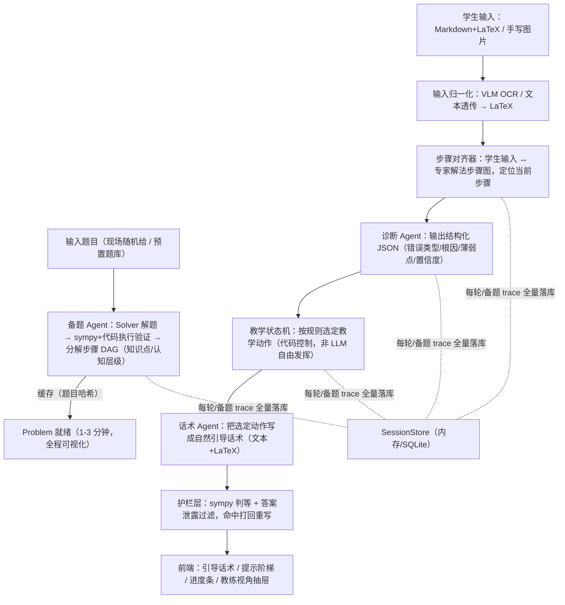
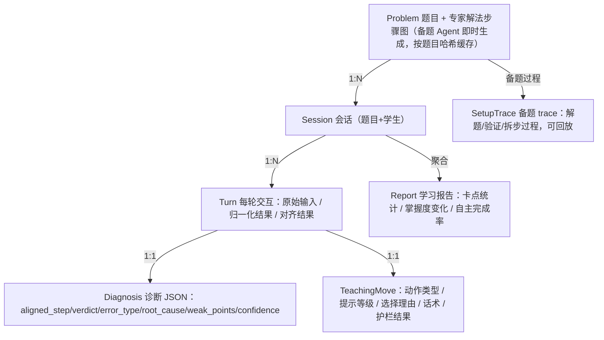
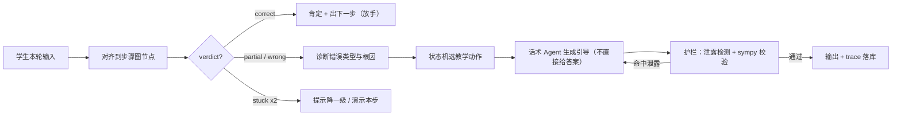
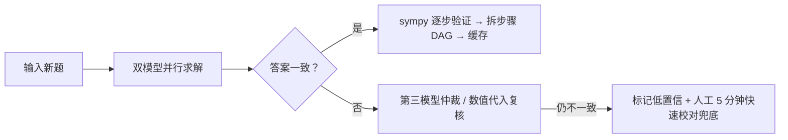

# 「启思」AI 数学思维教练 — 产品方案设计

需求背景：AI 辅助学习"作业得分升、考试成绩降"（Wharton 研究：练习 +48%，考试 **-17%**），根因是 AI 介入干扰深入思考；优质 1对1 真人家教"现场诊断 + 引导启发"稀缺昂贵。

**一句话方案**：把"会解题"和"会教学"拆成两个角色，把"诊断"做成结构化数据，把"教学策略"做成显式状态机——用架构而非 prompt 解决三大痛点。

**评审对齐**：① 诊断薄弱点 → 痛点一方案 ② 教学步骤合理 → 痛点一/二方案 ③ 重视学生自主性 → 痛点二方案；AI 能力体现 → 痛点三方案。

演示形态：Web（Next.js + KaTeX + FastAPI）。演示题目：**支持现场随机给题**（备题 Agent 即时处理，1-3 分钟出步骤图），另预置 2-3 道已缓存真题兜底。

## 总体设计

### 整体架构

执行逻辑：拆成「备题 Agent」与「在线教学」两条链路。**备题链路收到题目后即时运行**（Solver 解题 → sympy/代码执行验证数值 → 分解为步骤 DAG，每步标注知识点与认知层级），按题目哈希缓存，同题免重跑；备题全程 trace 可视化，本身即是"AI 能力体现"的演示点。在线教学阶段每轮学生输入走「归一化 → 对齐 → 诊断 → 状态机选动作 → 话术生成 → 护栏」流水线，教学策略由代码状态机决定，LLM 只负责话术。

### 数据模型总览

核心实体四个：`Problem`（备题 Agent 即时生成的题目与步骤图，是诊断的"标准答案坐标系"，按题目哈希缓存）、`Session`（一次教学会话）、`Turn`（每轮交互及其 trace，评委可回放）、`Diagnosis`（结构化诊断结果，三个痛点的数据基石）。原型期单机 SQLite/内存即可。

## 痛点实现一：如何识别思维卡点，并高质量干预

### 技术方案设计

💡 **诊断依据 = 学生输入与专家步骤图的偏差**，不是 LLM 拍脑袋；干预 = 显式状态机选动作，LLM 只写话术。诊断与策略分离，保证可解释、可复现、可展示。步骤图由**备题 Agent 即时生成**，支持考核现场随机给题。

*   **备题 Agent（收到题目即时运行，目标 1-3 分钟）**：
    *   Solver（NuminaMath 或商业 API）解题，**双模型交叉求解**（两个模型分别解，答案一致才放行）；
    *   sympy + 代码执行验证每个数值/方程步骤；
    *   分解为步骤 DAG（每步标注：知识点、认知层级、标准中间结果）；
    *   按题目哈希缓存——预置的 2-3 道真题免现场重跑，随机新题现场生成；
    *   备题 trace 全程落库可视化（教练视角可看"AI 是怎么备这道题的"）。
*   **步骤对齐器**：LLM 分类任务 + 强制 JSON 输出，把学生输入映射到步骤图节点，输出 `aligned_step / verdict(partial_correct|wrong|stuck|skipped_ahead)`。
*   **诊断 Agent**：输入（题目+步骤图+会话历史+本轮输入）→ 输出强制 JSON：`error_type`（concept\_gap / procedural / careless / strategy / notation 枚举）、`root_cause`、`weak_points[]`、`confidence`。字段设计对齐 **MathTutorBench** 教学能力维度。
*   **教学状态机（核心自建，纯 Python \~100 行）**：动作集 `澄清追问 / 提示L1方向性提问 / 提示L2策略点拨 / 提示L3类比示例 / 演示本步 / 请学生重做`；升降级规则代码控制：**连续 2 次 stuck 才降一级提示，学生做对立即回退"放手"状态**。
*   **话术与策略分离**：模型只把"选定的动作 + 诊断根因"写成自然话术，规则管"何时给什么"，模型管"怎么写"。

### 核心流程

备题前置流程（现场随机给题时）：

### 接口设计

| 接口     | 路径                             | 方法   | 说明                                           |
| ------ | ------------------------------ | ---- | -------------------------------------------- |
| 备题     | /api/problems/setup            | POST | 入参题目文本/图片，异步任务：返回 setupId，完成后步骤图就绪；进度可轮询     |
| 备题进度   | /api/problems/{setupId}/status | GET  | 返回备题阶段（求解/验证/拆步）与 trace，前端可视化                |
| 创建会话   | /api/sessions                  | POST | 入参 problemId，返回 sessionId + 学习契约             |
| 提交一轮输入 | /api/sessions/{id}/turns       | POST | 入参文本或图片，同步返回：诊断 JSON + 引导话术 + 提示等级 + traceId |
| 获取教练视角 | /api/turns/{traceId}           | GET  | 返回该轮完整决策链（识别→对齐→诊断→动作理由→话术）                  |
| 学习报告   | /api/sessions/{id}/report      | GET  | 卡点统计 / 掌握度 / 自主完成率                           |
| 题目列表   | /api/problems                  | GET  | 已缓存真题（含步骤图元信息）                               |

### 开源复用备注

| 组件        | 复用方式          | 来源                                                          |
| --------- | ------------- | ----------------------------------------------------------- |
| 求解 Solver | 直接复用 + 代码执行验证 | AI-MO/NuminaMath（高考级数学模型），双模型交叉用商业 API                      |
| 数值校验      | 直接复用          | sympy 判等/代入                                                 |
| 诊断字段设计    | 参考改造          | MathTutorBench（arXiv 2504.08649）8 个教学能力维度                   |
| 诊断清单设计    | 参考改造          | SenmuuuuW/universal-diagnostic-tutor-skill（205★，诊断优先 skill） |
| 多模型接入     | 直接复用          | OpenAI 兼容接口（Qwen-Max / DeepSeek / GPT 可切）                   |

## 痛点实现二：用户如何感知"在培养思维，不是给答案步骤"

### 技术方案设计

💡 **机制层强制，不靠 UI 话术**：提示要"挣"出来，答案被机器拦住，自主性被数字看见。

*   **提示阶梯（hint ladder）显式编号**：界面呈现"提示 1/3"，学生必须**先提交自己的尝试**才能解锁下一级——把 Khanmigo / ChatGPT Study Mode 的交互范式产品化。
*   **答案泄露过滤器（独立校验 Agent）**：每条回复与最终答案 + 关键中间结果比对（文本比对 + 数值检查），检出"直接给答案"即打回话术 Agent 重写——对"重视学生自主性"维度的机器级保障。
*   **进度可视化**：`你完成 x/y 步` + 每步标记 `你完成✅ / 老师演示⚠️`，实时可见自主率。
*   **学习契约**：开题时明示本课规则（AI 不直接给答案，会分步引导），管理预期。
*   **结束学习报告**：卡点归因汇总 + 知识点掌握变化 + 自主完成率，让学生感到"它懂我哪里不会"。

### 接口设计

| 接口      | 路径                          | 方法   | 说明                                 |
| ------- | --------------------------- | ---- | ---------------------------------- |
| 解锁下一级提示 | /api/turns/{id}/hint        | POST | 校验学生已提交尝试后放行 hint N+1，未提交返回 403+原因 |
| 进度查询    | /api/sessions/{id}/progress | GET  | 返回步骤完成明细（每步谁完成/提示等级）               |
| 泄露过滤    | 内部（护栏层）                     | —    | 命中泄露 → 打回重写，trace 中记录拦截事件（演示可讲）    |

### 开源复用备注

| 组件             | 复用方式 | 来源                                                  |
| -------------- | ---- | --------------------------------------------------- |
| 分层提示 prompt 结构 | 参考改造 | JushBJJ/Mr.-Ranedeer-AI-Tutor（29.6k★，分层 hint/风格配置化） |
| "不给答案"约束话术     | 参考改造 | Ljyustc/SocraticLM（179★，Socratic 约束设计）              |
| 多角色轮转模板        | 参考改造 | RunzheYang/SocraticAI（260★，导师/评论家/求解者）              |

## 痛点实现三：AI 的能力究竟如何体现出来

### 技术方案设计

💡 **教练视角抽屉 = 演示杀手锏**：每轮推理链结构化落库，一键展开，评委逐条核对三个评分维度。备题 Agent 的解题/验证/拆步过程同样进教练视角——随机给题的现场，"看 AI 当场备题"就是最直接的 AI 能力演示。

*   **每轮 trace 全量落库**：输入识别 → 对齐结果（命中第几步、依据）→ 诊断 JSON（含置信度）→ 备选教学动作列表与选择理由 → 最终话术 → 护栏结果。
*   **备题 trace**：双模型求解对比、sympy 验证结果、步骤拆分依据，全部落库可回放。
*   **教练视角面板**：前端抽屉按轮渲染上述 trace；支持会话级回放，任意一轮可复盘"AI 当时怎么想的"。
*   **可信度外显**：诊断置信度低（< 0.6）时自动切"澄清追问"动作并明示"我需要确认一下"，把不确定性变成教学动作而不是硬猜。
*   **报告页收尾**：整场会话的错误类型分布、知识点掌握变化、自主完成率，AI 能力以数据收口。

### 接口设计

| 接口       | 路径                            | 方法  | 说明                   |
| -------- | ----------------------------- | --- | -------------------- |
| 轮级 trace | /api/turns/{traceId}          | GET | 单轮完整决策链 JSON         |
| 备题 trace | /api/problems/{setupId}/trace | GET | 备题全过程决策链（求解对比/验证/拆步） |
| 会话回放     | /api/sessions/{id}/trace      | GET | 全会话 trace 时间线        |
| 学习报告     | /api/sessions/{id}/report     | GET | 与痛点二共用               |

### 开源复用备注

| 组件                   | 复用方式 | 来源                                        |
| -------------------- | ---- | ----------------------------------------- |
| 结构化输出约束（JSON schema） | 直接复用 | OpenAI structured output / Qwen JSON mode |
| 评测维度叙事               | 参考改造 | MathTutorBench 8 维度作为演示讲解话术框架             |

## 通用输入能力（支撑三个痛点）

*   **文本输入**：Markdown + LaTeX，前端 KaTeX 实时渲染（开源）。
*   **手写输入**：上传手写解题图 → 主走 Qwen-VL API 识别为 LaTeX；本地备选 **Pix2Text**（3.2k★，MIT）或 **Texo**（0.9k★，20M 参数浏览器端 ONNX，零 GPU，演示现场兜底）；识别结果回显让学生确认，防 OCR 误诊。

## 风险与对策

| 风险                | 对策                                                                 |
| ----------------- | ------------------------------------------------------------------ |
| 备题 Agent 解错题 / 超时 | 双模型交叉求解 + sympy 逐步验证；仍不一致走第三模型仲裁或标记低置信 + 人工 5 分钟快速校对兜底；预置缓存题兜底演示流程 |
| 备题现场等待时间          | 目标 1-3 分钟内完成；等待期间前端可视化备题过程（变成演示点而非冷场）                              |
| OCR 识别错导致误诊       | 识别结果回显确认；诊断带 confidence，低置信走澄清追问                                   |
| LLM 话术夹带答案        | 泄露过滤器 + 状态机约束双层保险，拦截事件进 trace 可演示                                  |
| 现场网络/模型故障         | 双模型配置；Texo 浏览器端 OCR 兜底；演示脚本含离线录屏                                   |

## 里程碑（2-3 人 × 5-7 天）

| 阶段   | 内容                                                        | 验收             |
| ---- | --------------------------------------------------------- | -------------- |
| D1-2 | 备题 Agent pipeline（解题/验证/拆步/缓存）+ FastAPI 会话骨架 + 前端对话/KaTeX | 随机给题 3 分钟内出步骤图 |
| D3-4 | 对齐器 + 诊断 Agent + 状态机 + 提示阶梯 + 泄露护栏                        | 全程不给答案完成一题     |
| D5   | 教练视角（含备题 trace）、进度条、学习报告                                  | 三个评分维度均有对应展示   |
| D6   | 手写 OCR 接入；第 2 道真题全链路验证                                    | 手写图可用          |
| D7   | prompt 调优 + 演示脚本排练                                        | 15 分钟演示彩排通过    |

## 参考资料

*   论文：Bastani et al., *Generative AI Can Harm Learning*（Wharton, 2024）；*MathTutorBench*（arXiv 2504.08649）；Google *LearnLM* 技术报告
*   产品对标：Khanmigo、ChatGPT Study Mode、Claude Learning Mode、Google Guided Learning；学而思九章 MathGPT、猿辅导海豚 AI、豆包爱学、松鼠 AI
*   开源仓库：Pix2Text、Texo、LaTeX\_OCR\_PRO、texify、Mr.-Ranedeer-AI-Tutor、SocraticAI、SocraticLM、universal-diagnostic-tutor-skill、math-question-bank、NuminaMath
*   调研详情见：《AI数学思维教练-市面产品与开源实现调研》

